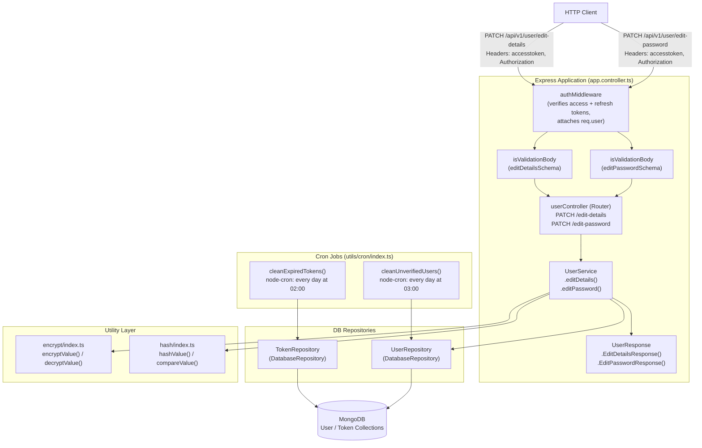
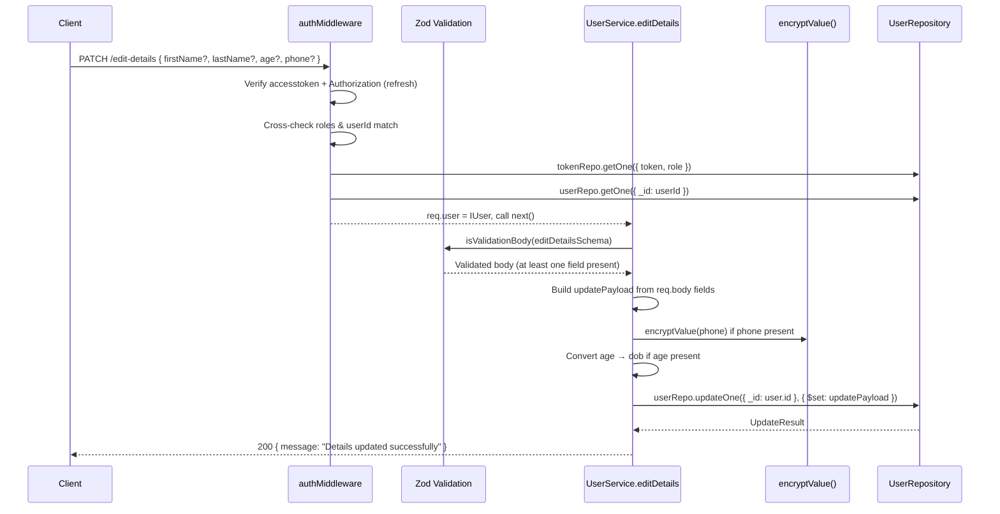
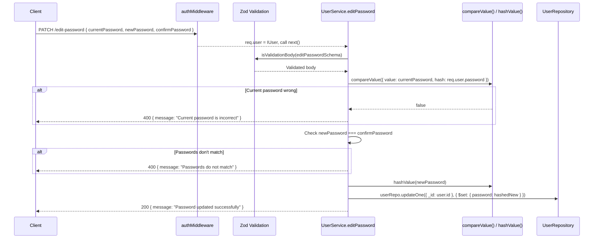
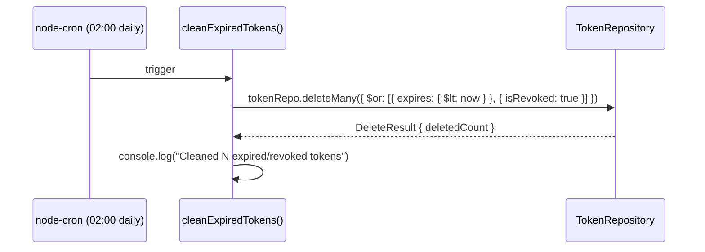
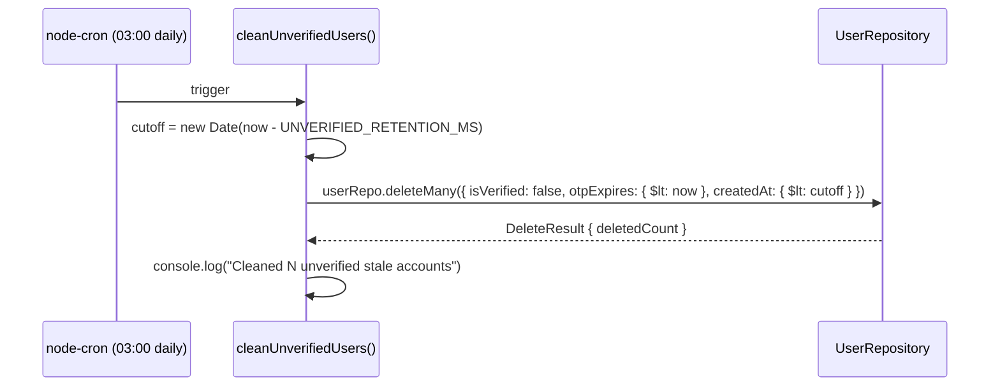

# Design Document: User Profile Management

## Overview

This feature extends the EduLearn platform with four capabilities for authenticated users and system maintenance:
**Edit User Details** (name, age via `dob`, encrypted phone), **Edit Password** (bcrypt-verified current password + new password confirmation), and two **cron jobs** — one that purges expired/revoked tokens from the Token collection, and one that deletes unverified user accounts whose OTPs have expired beyond a configurable retention window.

All HTTP endpoints follow the existing EduLearn pattern: `authMiddleware` → Zod validation middleware → `asyncHandleError`-wrapped service method. The cron jobs are initialized once inside the `bootstrap()` function in `src/app.controller.ts` using `node-cron`.

---

## Architecture



---

## Sequence Diagrams

### Edit User Details Flow



### Edit Password Flow



### Cron: Clean Expired/Revoked Tokens



### Cron: Clean Unverified Users



---

## Components and Interfaces

### Component 1: UserValidation (`src/modules/user/use.validation.ts`)

**Purpose**: Defines Zod schemas for request body validation on the two new PATCH endpoints.

**Interface**:
```typescript
class UserValidation {
    public editDetailsSchema: z.ZodObject<{
        firstName?: z.ZodOptional<z.ZodString>;
        lastName?: z.ZodOptional<z.ZodString>;
        age?: z.ZodOptional<z.ZodNumber>;   // client sends age; service converts → dob
        phone?: z.ZodOptional<z.ZodString>;
    }>;

    public editPasswordSchema: z.ZodObject<{
        currentPassword: z.ZodString;
        newPassword: z.ZodString;
        confirmPassword: z.ZodString;
    }>;
}
```

**Responsibilities**:
- Ensure at least one of `firstName | lastName | age | phone` is present for the edit-details endpoint (via `.refine()`).
- Enforce `newPassword` minimum length (≥ 6 characters).
- Block unknown fields via `.strictObject()` consistent with `AuthValidation`.

---

### Component 2: UserService (extended — `src/modules/user/user.service.ts`)

**Purpose**: Adds `editDetails` and `editPassword` handler methods, following the existing `asyncHandleError` pattern.

**Interface**:
```typescript
class UserService {
    constructor(
        private readonly userResponse: UserResponse,
        private readonly userRepository: UserRepository,
    ) {}

    public getInformationUser: RequestHandler;  // existing
    public editDetails: RequestHandler;          // new
    public editPassword: RequestHandler;         // new
}
```

**Responsibilities**:
- `editDetails`: Build a partial update payload from validated body fields; encrypt `phone` with `encryptValue()`; derive `dob` from `age`; call `userRepository.updateOne()`.
- `editPassword`: Verify `currentPassword` against `req.user.password` via `compareValue()`; check `newPassword === confirmPassword`; hash the new password via `hashValue()`; persist update.

---

### Component 3: UserResponse (extended — `src/modules/user/user.response.ts`)

**Purpose**: Provides response mapper methods for the new endpoints.

**Interface**:
```typescript
class UserResponse {
    public InfoUser(user: IUser): object;         // existing
    public EditDetailsResponse(): object;          // new
    public EditPasswordResponse(): object;         // new
}
```

---

### Component 4: userController (extended — `src/modules/user/user.controller.ts`)

**Purpose**: Mounts the two new PATCH routes with auth and validation middleware.

**Routes added**:
```typescript
userController.patch(
    "/edit-details",
    authMiddleware,
    isValidationBody(userValidation.editDetailsSchema),
    userService.editDetails
);

userController.patch(
    "/edit-password",
    authMiddleware,
    isValidationBody(userValidation.editPasswordSchema),
    userService.editPassword
);
```

---

### Component 5: Cron Jobs (`src/utils/cron/index.ts`)

**Purpose**: Houses `node-cron` scheduled tasks for database hygiene.

**Interface**:
```typescript
export function initCronJobs(
    tokenRepo: TokenRepository,
    userRepo: UserRepository
): void;
```

**Responsibilities**:
- `cleanExpiredTokens`: runs daily at 02:00, deletes Token documents where `expires < now` OR `isRevoked === true`.
- `cleanUnverifiedUsers`: runs daily at 03:00, deletes User documents where `isVerified === false` AND `otpExpires < now` AND `createdAt < (now - UNVERIFIED_RETENTION_MS)`.

---

## Data Models

### DTO: EditDetailsDTO (`src/modules/user/user.dto.ts` — new file)

```typescript
export interface EditDetailsDTO {
    firstName?: string;
    lastName?: string;
    age?: number;       // positive integer; service derives dob = new Date(now - age * 365.25 days)
    phone?: string;
}
```

**Validation Rules**:
- At least one field must be present.
- `firstName` / `lastName`: non-empty string, min length 2.
- `age`: positive integer between 1 and 120.
- `phone`: non-empty string (format validation optional; encrypted before storage).

---

### DTO: EditPasswordDTO (`src/modules/user/user.dto.ts`)

```typescript
export interface EditPasswordDTO {
    currentPassword: string;
    newPassword: string;
    confirmPassword: string;
}
```

**Validation Rules**:
- All three fields required.
- `newPassword` min 6 characters.
- `newPassword === confirmPassword` (enforced in service, not schema — mirrors existing auth pattern).

---

### Update Payload (internal, built by service)

```typescript
// Edit Details internal payload
interface EditDetailsUpdatePayload {
    firstName?: string;
    lastName?: string;
    dob?: Date;       // derived from age
    phone?: string;   // encrypted with encryptValue()
    updatedAt: Date;  // always set to new Date()
}

// Edit Password internal payload
interface EditPasswordUpdatePayload {
    password: string;  // bcrypt hash from hashValue(newPassword)
    updatedAt: Date;
}
```

---

## Key Functions with Formal Specifications

### `UserService.editDetails`

```typescript
public editDetails = asyncHandleError(
    async (req: Request, res: Response): Promise<Response>
)
```

**Preconditions:**
- `req.user` is a valid `IUser` (guaranteed by `authMiddleware`).
- `req.body` has passed `editDetailsSchema` validation (at least one field present).

**Postconditions:**
- Exactly the provided fields are updated in the User document; unmentioned fields remain unchanged.
- If `phone` is provided, the stored value is the AES-encrypted ciphertext of the input.
- If `age` is provided, `dob` is stored as `new Date(Date.now() - age * 365.25 * 24 * 60 * 60 * 1000)`.
- Returns HTTP 200 with a success message.

**Loop Invariants:** N/A (no loops; single DB update operation).

---

### `UserService.editPassword`

```typescript
public editPassword = asyncHandleError(
    async (req: Request, res: Response): Promise<Response>
)
```

**Preconditions:**
- `req.user` is a valid `IUser` with a non-empty bcrypt `password` hash.
- `req.body` has passed `editPasswordSchema` validation.

**Postconditions:**
- If `currentPassword` does not match the stored hash → returns HTTP 400, no DB write occurs.
- If `newPassword !== confirmPassword` → returns HTTP 400, no DB write occurs.
- If both checks pass → `user.password` is updated to `hashValue(newPassword)`.
- Returns HTTP 200 with a success message on success.

**Loop Invariants:** N/A.

---

### `cleanExpiredTokens`

```typescript
async function cleanExpiredTokens(tokenRepo: TokenRepository): Promise<void>
```

**Preconditions:**
- `tokenRepo` is an initialized `TokenRepository` instance.

**Postconditions:**
- All Token documents satisfying `expires < now || isRevoked === true` are permanently deleted.
- Documents that are neither expired nor revoked are untouched.
- The deletion count is logged to console.

---

### `cleanUnverifiedUsers`

```typescript
async function cleanUnverifiedUsers(userRepo: UserRepository): Promise<void>
```

**Preconditions:**
- `userRepo` is an initialized `UserRepository` instance.
- `UNVERIFIED_RETENTION_MS` is a positive integer (milliseconds) representing the grace period after OTP expiry before the account is purged.

**Postconditions:**
- All User documents satisfying `isVerified === false && otpExpires < now && createdAt < (now - UNVERIFIED_RETENTION_MS)` are permanently deleted.
- Verified users and recently-created unverified users are untouched.
- The deletion count is logged to console.

---

## Algorithmic Pseudocode

### Edit Details Algorithm

```pascal
PROCEDURE editDetails(req, res)
  INPUT:  req.user (IUser), req.body (EditDetailsDTO)
  OUTPUT: HTTP Response

  SEQUENCE
    body ← req.body  // already validated by Zod middleware
    user ← req.user  // attached by authMiddleware

    updatePayload ← { updatedAt: new Date() }

    IF body.firstName IS PRESENT THEN
      updatePayload.firstName ← body.firstName
    END IF

    IF body.lastName IS PRESENT THEN
      updatePayload.lastName ← body.lastName
    END IF

    IF body.age IS PRESENT THEN
      updatePayload.dob ← new Date(Date.now() - body.age * 365.25 * 24 * 60 * 60 * 1000)
    END IF

    IF body.phone IS PRESENT THEN
      updatePayload.phone ← encryptValue(body.phone)
    END IF

    AWAIT userRepository.updateOne({
      filter: { _id: user.id },
      projection: { $set: updatePayload }
    })

    RETURN res.status(200).json({ message: "Details updated successfully" })
  END SEQUENCE
END PROCEDURE
```

**Preconditions:**
- `body` contains at least one field (enforced by Zod `.refine()`).
- `user.id` is a valid MongoDB ObjectId.

**Postconditions:**
- Only fields present in `body` are overwritten in MongoDB.
- `phone` is stored as AES ciphertext.
- `dob` reflects the age supplied.

---

### Edit Password Algorithm

```pascal
PROCEDURE editPassword(req, res)
  INPUT:  req.user (IUser), req.body (EditPasswordDTO)
  OUTPUT: HTTP Response

  SEQUENCE
    body ← req.body
    user ← req.user

    // Step 1: Verify current password
    isMatch ← AWAIT compareValue({ value: body.currentPassword, hash: user.password })

    IF NOT isMatch THEN
      RETURN res.status(400).json({ message: "Current password is incorrect" })
    END IF

    // Step 2: Confirm new passwords match
    IF body.newPassword ≠ body.confirmPassword THEN
      RETURN res.status(400).json({ message: "Passwords do not match" })
    END IF

    // Step 3: Hash and persist
    hashedPassword ← AWAIT hashValue(body.newPassword)

    AWAIT userRepository.updateOne({
      filter: { _id: user.id },
      projection: { $set: { password: hashedPassword, updatedAt: new Date() } }
    })

    RETURN res.status(200).json({ message: "Password updated successfully" })
  END SEQUENCE
END PROCEDURE
```

**Preconditions:**
- `user.password` is a valid bcrypt hash (guaranteed by registration flow).
- `body.newPassword` meets minimum length (enforced by Zod).

**Postconditions:**
- On mismatch: No DB write; 400 returned.
- On success: `user.password` in MongoDB is the bcrypt hash of `newPassword`.

---

### Clean Expired Tokens Algorithm

```pascal
PROCEDURE cleanExpiredTokens(tokenRepo)
  INPUT:  tokenRepo (TokenRepository)
  OUTPUT: void (side-effect: DB deletion + console log)

  SEQUENCE
    now ← new Date()

    result ← AWAIT tokenRepo.deleteMany({
      filter: {
        $or: [
          { expires: { $lt: now } },
          { isRevoked: true }
        ]
      }
    })

    PRINT "Cleaned " + result.deletedCount + " expired/revoked tokens at " + now
  END SEQUENCE
END PROCEDURE
```

---

### Clean Unverified Users Algorithm

```pascal
PROCEDURE cleanUnverifiedUsers(userRepo)
  INPUT:  userRepo (UserRepository)
  OUTPUT: void (side-effect: DB deletion + console log)

  CONSTANT UNVERIFIED_RETENTION_MS = 24 * 60 * 60 * 1000  // 24 hours (configurable)

  SEQUENCE
    now    ← new Date()
    cutoff ← new Date(now.getTime() - UNVERIFIED_RETENTION_MS)

    result ← AWAIT userRepo.deleteMany({
      filter: {
        isVerified: false,
        otpExpires: { $lt: now },
        createdAt:  { $lt: cutoff }
      }
    })

    PRINT "Cleaned " + result.deletedCount + " stale unverified accounts at " + now
  END SEQUENCE
END PROCEDURE
```

**Loop Invariants:** N/A — both cron procedures perform a single atomic `deleteMany` call.

---

### Cron Initialization Algorithm

```pascal
PROCEDURE initCronJobs(tokenRepo, userRepo)
  INPUT:  tokenRepo (TokenRepository), userRepo (UserRepository)
  OUTPUT: void (side-effect: schedules two cron tasks)

  SEQUENCE
    // Schedule token cleanup: every day at 02:00 server time
    cron.schedule("0 2 * * *", ASYNC FUNCTION
      TRY
        AWAIT cleanExpiredTokens(tokenRepo)
      CATCH err
        PRINT "Token cleanup error: " + err.message
      END TRY
    )

    // Schedule unverified-user cleanup: every day at 03:00 server time
    cron.schedule("0 3 * * *", ASYNC FUNCTION
      TRY
        AWAIT cleanUnverifiedUsers(userRepo)
      CATCH err
        PRINT "Unverified user cleanup error: " + err.message
      END TRY
    )
  END SEQUENCE
END PROCEDURE
```

---

## Error Handling

### Edit Details

| Scenario | HTTP Status | Message |
|---|---|---|
| Missing auth token | 401 | `"Unauthorized"` (from `authMiddleware`) |
| Token revoked / expired | 403 | `"Token revoked"` / `"Refresh token expired"` |
| Body fails Zod validation (no fields, unknown fields) | 400 | Zod error response from `isValidationBody` middleware |
| MongoDB update fails | 500 | Global error handler via `asyncHandleError` |

### Edit Password

| Scenario | HTTP Status | Message |
|---|---|---|
| Missing / invalid auth | 401 / 403 | From `authMiddleware` |
| Body fails Zod validation | 400 | Zod error response |
| `currentPassword` does not match | 400 | `"Current password is incorrect"` |
| `newPassword !== confirmPassword` | 400 | `"Passwords do not match"` |
| MongoDB update fails | 500 | Global error handler |

### Cron Jobs

| Scenario | Handling |
|---|---|
| MongoDB connection unavailable | `try/catch` inside cron callback; error logged, task skipped silently |
| `deleteMany` partial failure | Mongoose throws; caught and logged |

---

## Testing Strategy

### Unit Testing Approach

Test each service method and cron function in isolation using mocked repositories.

Key test cases:
- `editDetails`: only provided fields are included in the `$set` payload; `phone` is encrypted; `age` correctly converts to `dob`.
- `editPassword`: returns 400 when `compareValue()` returns `false`; returns 400 when passwords don't match; hashed password is persisted on success.
- `cleanExpiredTokens`: `deleteMany` is called with the correct `$or` filter containing the current timestamp.
- `cleanUnverifiedUsers`: `deleteMany` is called with the correct composite filter; retention cutoff is calculated correctly.

### Property-Based Testing Approach

**Property Test Library**: `fast-check`

Key properties:
- For any valid `EditDetailsDTO` with at least one field, the update payload must contain exactly those keys (plus `updatedAt`) and no others.
- For any phone string, `decryptValue(encryptValue(phone)) === phone` (round-trip encryption property).
- For any `age` in `[1, 120]`, the derived `dob` satisfies `Math.round((now - dob) / (365.25 * 24 * 3600 * 1000)) === age`.
- For any password, `compareValue({ value: pw, hash: hashValue(pw) }) === true` (bcrypt round-trip).

### Integration Testing Approach

Test against a real (or in-memory) MongoDB instance:
- Full PATCH `/edit-details` request with valid JWT headers updates only the specified fields.
- Full PATCH `/edit-password` flow: register → login → change password → verify new password works.
- Cron helpers: seed expired/revoked tokens, call `cleanExpiredTokens()`, assert collection is empty for matching docs.

---

## Performance Considerations

- **Cron queries are index-friendly**: the Token cleanup filter uses `expires` and `isRevoked`; consider a compound index `{ expires: 1, isRevoked: 1 }`. The unverified-user cleanup filter uses `isVerified`, `otpExpires`, and `createdAt`; consider a compound index `{ isVerified: 1, otpExpires: 1, createdAt: 1 }`.
- **Edit-details update** is a single `updateOne` on `_id` (indexed by default) — O(1) lookup.
- **Bcrypt cost**: `hashValue` and `compareValue` use the configured `SALT_ROUND`. The edit-password endpoint is async and non-blocking for other requests.
- **Cron scheduling offset**: running token cleanup at 02:00 and user cleanup at 03:00 staggers DB load during off-peak hours.

---

## Security Considerations

- **Phone encryption**: `encryptValue()` uses CryptoJS AES with the `ENCRYPT_KEY` env variable. The key must not be committed to source control and should be rotated if compromised.
- **Password change authentication**: The `currentPassword` verification step prevents an attacker with a stolen session token from silently resetting the account password.
- **`req.user` injection**: `authMiddleware` populates `req.user` only after verifying both the access token signature and the refresh token's non-revoked state in MongoDB, so the user object is trustworthy.
- **CORS restriction**: The existing CORS config allows `PATCH` only after `PUT`/`DELETE`/`POST`/`GET` is allowed — verify `PATCH` is included in the `methods` array in `app.controller.ts`.
- **Cron data destruction**: `deleteMany` calls are irreversible. Ensure the cron filter conditions are well-tested before deploying to production. The `UNVERIFIED_RETENTION_MS` constant must be long enough to allow legitimate users to verify their email (recommend ≥ 24 hours).
- **Rate limiting**: The existing `express-rate-limit` (100 req / 15 min per IP) applies globally and covers the new PATCH routes.

---

## Dependencies

| Dependency | Purpose | Status |
|---|---|---|
| `node-cron` | Schedule recurring cron jobs | **Not yet installed** — run `npm install node-cron` |
| `@types/node-cron` | TypeScript types for node-cron | **Not yet installed** — run `npm install -D @types/node-cron` |
| `bcrypt` | Password hashing via `hashValue()` / `compareValue()` | Already installed |
| `crypto-js` | Phone encryption via `encryptValue()` / `decryptValue()` | Already installed |
| `zod` | Request body validation schemas | Already installed |
| `mongoose` | MongoDB repository layer | Already installed |
| `express` | HTTP routing | Already installed |

> **Install command**: `npm install node-cron && npm install -D @types/node-cron`

---

## Correctness Properties

*A property is a characteristic or behavior that should hold true across all valid executions of a system — essentially, a formal statement about what the system should do. Properties serve as the bridge between human-readable specifications and machine-verifiable correctness guarantees.*

### Property 1: Edit-Details Payload Exactness

*For any* valid `EditDetailsDTO` containing a non-empty subset of `{ firstName, lastName, age, phone }`, the update payload built by `UserService.editDetails` SHALL contain exactly those keys (plus `updatedAt`) and no additional keys.

**Validates: Requirements 1.1**

---

### Property 2: Phone Encryption Round-Trip

*For any* valid phone string, applying `encryptValue` followed by `decryptValue` SHALL return a value equal to the original phone string.

**Validates: Requirements 1.2, 8.1**

---

### Property 3: Age-to-DOB Derivation Correctness

*For any* integer `age` in the range `[1, 120]`, the `dob` value derived by the formula `new Date(Date.now() - age * 365.25 * 24 * 60 * 60 * 1000)` SHALL satisfy `Math.round((now - dob) / (365.25 * 24 * 3600 * 1000)) === age` at the time of computation.

**Validates: Requirements 1.3**

---

### Property 4: Edit-Details Schema Accepts Any Non-Empty Valid Subset

*For any* non-empty subset of the fields `{ firstName, lastName, age, phone }` where each field satisfies its individual validation rule (`firstName`/`lastName` ≥ 2 chars, `age` ∈ [1, 120], `phone` non-empty), the `editDetailsSchema` SHALL successfully validate the request body.

**Validates: Requirements 3.1**

---

### Property 5: Incorrect Current Password Prevents Database Write

*For any* two distinct passwords `storedPassword` and `suppliedPassword` where `suppliedPassword !== storedPassword`, when `UserService.editPassword` is called with `currentPassword = suppliedPassword` and the User document holds `hashValue(storedPassword)`, THE UserService SHALL return HTTP 400 with `"Current password is incorrect"` and SHALL NOT invoke `userRepository.updateOne`.

**Validates: Requirements 2.2**

---

### Property 6: Mismatched New Password and Confirmation Prevents Database Write

*For any* two distinct strings `newPassword` and `confirmPassword` where `newPassword !== confirmPassword` (and `currentPassword` is correct), when `UserService.editPassword` is called, THE UserService SHALL return HTTP 400 with `"Passwords do not match"` and SHALL NOT invoke `userRepository.updateOne`.

**Validates: Requirements 2.3**

---

### Property 7: Password Hashing Positive Round-Trip

*For any* valid password string `p`, `compareValue({ value: p, hash: hashValue(p) })` SHALL return `true`.

**Validates: Requirements 2.4, 9.1**

---

### Property 8: Password Hashing Negative Round-Trip

*For any* two distinct valid password strings `p1` and `p2` where `p1 !== p2`, `compareValue({ value: p1, hash: hashValue(p2) })` SHALL return `false`.

**Validates: Requirements 9.2**

---

### Property 9: Token Cleanup Filter Correctness

*For any* collection of Token-like documents with arbitrary combinations of `expires` (Date) and `isRevoked` (boolean) values, the filter used by `cleanExpiredTokens` SHALL select exactly those documents where `expires < now` OR `isRevoked === true`, and SHALL not select any document where `expires >= now` AND `isRevoked === false`.

**Validates: Requirements 5.2, 5.3**

---

### Property 10: Unverified User Cleanup Filter Correctness

*For any* collection of User-like documents with arbitrary combinations of `isVerified` (boolean), `otpExpires` (Date), and `createdAt` (Date) values, the filter used by `cleanUnverifiedUsers` SHALL select exactly those documents where `isVerified === false` AND `otpExpires < now` AND `createdAt < (now - UNVERIFIED_RETENTION_MS)`, and SHALL not select any document that does not satisfy all three conditions simultaneously.

**Validates: Requirements 6.2, 6.3**
